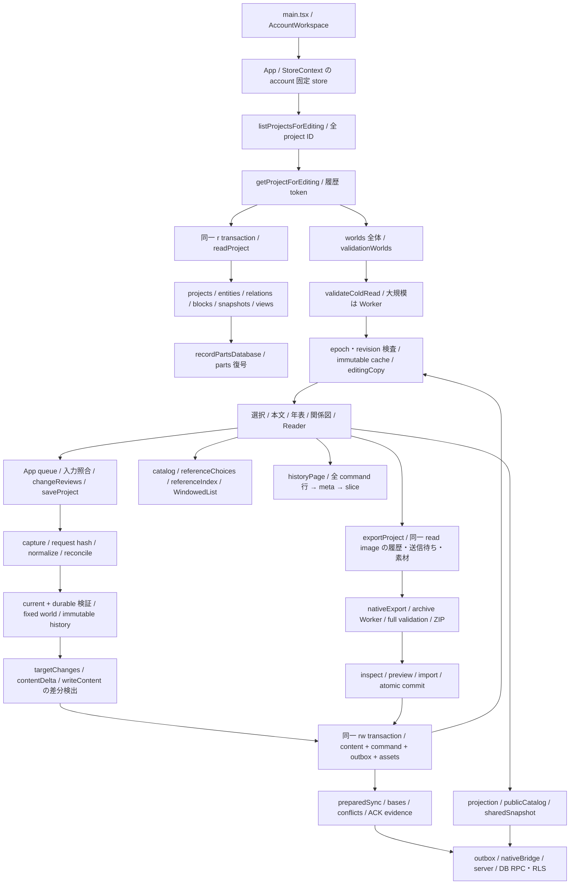

# 実装経路と監査結果

対象mainと原文の固定は [sources.json](sources.json)、全104IDの個別経路・原4条項の参照は [requirements.json](requirements.json)、AUD→OPT/要件の逆引きは [trace-index.json](trace-index.json)。同JSONの `freshAcceptance=NOT_PERFORMED` は、新規に全464条項を受け入れたという誤読を防ぐ。既存手順・実装への対応と、新しい動的結果を区別する。

## 読込・更新の依存図

入口から出口までの責任境界は次の通り。

| 経路 | 正本・副作用・依存 | 主要な検査入口 |
| --- | --- | --- |
| 作品一覧→編集 | App起動で全作品の編集用現在内容を取得。`readProject` は8192件のbatchに分けるが最終的に全配列を集める。履歴本文は省略済み。`workspaceInputs` とlocal draftを別に復元 | `getProjectForEditing`、`validateColdRead`、`readValidationCore`。構造・参照・world・hash・integrityを検査 |
| 入力→保存通知 | EntityEditorのdebounce、App queue、参照位置のremap、review生成、storeで再送・revision・履歴tokenを確認。通知はcommit成功後 | `saveProject`、`validateCurrentProject`、`validateProjectIntegrity`。失敗時に入力を保持 |
| 一括確定 | `projects/entities/relations/blocks/snapshots/views/commands/outbox/assets/syncMetadata` 等と `recordParts` を同じtransactionに含める。新規world pinも境界内 | 4故障注入点、operation再送、容量不足、保存中revision再検査。差分書込は既存実装 |
| 履歴 | `StoredCommand.delta` と64操作ごとのcheckpoint。pageは全metadataのID/作品照合を行うがbefore/afterの全再構築ではない。本文選択時は `materializeCommand` | missing row、親循環、baseRevision、project/operationID、履歴改竄。全量復元は別途完全検査 |
| 検索・参照 | catalogの索引/正規化WeakMapは一回のcompile内、UI逆引きはimmutable配列に紐付くWeakMap。候補は本文と別の派生値 | 同名別ID、改名、削除、別名、読み、pin不在、過去版、順序。公開索引はprojection後に作る |
| 年表・関係図・試読 | Timeline/Relationships/Readerは同じ作品ID・状態・参照を使う。図配置・提示順と正本世界時間を区別 | world timeの文字列tick、relationGraph、runtime/analysis Worker、固定版・経路・乱数の照合 |
| 完全保存→復元 | `exportProject` がcurrent・command・pending・sync recovery・world registryを同一読込像に捕捉。凍結/共有化してexport Workerへ。inspect/preview/newImport/importWorkの検査後に確定 | archive quotas、全素材SHA、全履歴・pin、形式major、取消、new/clone/cold、最終commit故障。通常編集の履歴省略を完全保存へ流用しない |
| 同期・限定共有 | `outbox` は保存待ち、`syncBases/preparedSync/syncConflicts/syncAckEvidence` は別の確定状態。accountに固定したstoreとsession generation、ACK hash/IDを検査 | `SyncOutbox`、`nativeBridge`、`validateServerImage/applyNativeOperation`、projection/publicShare。RPC・RLS・private Storageは静的追跡のみ。実Auth未実行 |

## AUD-001〜023

`OBS` の生値は [測定](MEASUREMENT.md) とevidenceを参照。否定条件は、後続で主要因・改善効果の仮説を棄却する具体条件。今回、性能最適化そのものは実装していない。

| AUD | 現在の事実・結果 | 関数/path・依存 | 反例・残る検証・設計先 |
| --- | --- | --- | --- |
| 001 | CODE/OBS: 起動は `listProjectsForEditing` で全IDを逐次読む。旧監査の `listProjects` と現在のApp入口を区別。1/10/50作品で現在行が全作品分 | `App.tsx`、`store.ts:listProjectsForEditing/getProjectForEditing` | 非選択作品破損が一覧全体を失敗させる。header化の効果は未実装。D01 |
| 002 | CODE/OBS: 編集は全currentとblocksを取得、commandsは0。8192batchと必要時取得は別 | `store.ts:readProject`、`readBatches.test.ts` | 部分データを全件validatorへ渡して欠損と誤判定しない。選択章だけでglobal制約を省く案は不可。D02 |
| 003 | CODE: epoch/lifetime/revision/historyIDsを照合し、古い読込で新cacheを上書きしない | `rememberProject/invalidateProjectCache`、`cacheConcurrency.test.ts`、account固定store | 保存/取消/account/roleの交差が必要。cache gaugeは保持量であってGC証明ではない。D05 |
| 004 | CODE: partsをnative rowと同じ取引に保存。decodeで全parts・index・headerを照合 | `recordPartsDatabase.ts:decode/mutate/wait` | 分割行だけを未検証で読まない。Worker取消/最終commitの原子拒否は既存回帰を維持。D02/D13 |
| 005 | CODE/OBS: compound query内の索引は1回、次のcompileで再構築。2検索で2buildを観測 | `catalog.ts:compileCatalogQuery/buildQueryIndex` | 複数作品・版・roleを共有するglobal cacheは不可。派生索引の再生成全一致が条件。D06 |
| 006 | CODE: useMemoのfilterと全ID→index Mapの後に30件表示。元からmemo化済み | `WindowedList.tsx`、`ListWindow.tsx` | DOM減少をDB行数減少と呼ばない。選択追従・検索解除の順序/位置を保持。D07 |
| 007 | CODE/OBS: calendar scopeでも分岐前にactive entityと候補/名前を全件準備 | `referenceChoices.ts`、`referenceProject` | pin不在でcurrentに戻さない。全scopeのID/label/orderは原回帰が対照。D08 |
| 008 | CODE: UI逆引きは配列WeakMap、prepareは600件/8msずつyield。catalog/検証とは別 | `ui/referenceIndex.ts`、`maintenance.ts`、`stateUsage.ts` | mutable draft・旧array・削除・target kindで失効。索引生成回数を合算して同一仕事と推定しない。D06/D11 |
| 009 | CODE: 手動分類group、名前/読み/別名、確定リンク、linkCandidates、publicCatalogは分離されている | `catalog.ts`、`linkCandidates.ts`、`publicCatalog.ts`、`projection.ts` | 自動候補を真実/正式参照へ昇格しない。公開はprojection後のIDだけ。D10 |
| 010 | CODE: model→schema.jsonは生成済み。fieldSpecs・検索除外・本文対象・公開allowlistは別定義 | `model.ts/types.ts/generate-schema.mjs`、`fieldSpecs.ts`、`projection.ts` | 重複は即不一致ではない。全項目意味の独立expectationなしに一括生成しない。D09 |
| 011 | CODE/OBS: request hashは履歴省略current＋historyIDs。normalize/targetChanges/contentDelta/writeContentに全配列処理。実書込は変更行 | `store.ts:saveProject`、`json.ts:sha256` | 新profileで走査数/hash実bytesを分離。hashゼロ化は再送契約破壊。5.22秒の全寄与を過去値から推定しない。D03 |
| 012 | CODE/OBS: delta/checkpointは既存。historyPageは100/1000/10000行取得→meta→reverse/filter→slice | `historyPage/historyCommand/materializeCommand` | 単純sliceは画面外missing rowを見落とす追加反例で棄却。D04 |
| 013 | CODE: immutable capture/record dictionary/検証session/分割Worker/graph transportを再利用済み | `archiveData/nativeExport/workerGraph/recordDictionary`、`contentValidationMemo` | 共有済み処理を未実装扱いしない。Worker内部CPU/hashは新probeではUNKNOWN。D13 |
| 014 | HIST: 元88,003・実72MiB・113履歴のnew/clone/cold成功は1fc/build8ecの証拠。旧timeoutは現mainの失敗ではない | `pr49-followup/evidence/local-formal-summary.json`、`large-history-verification-entry.mjs` | 今回のLarge30は起動/日常操作用。112編集/113履歴/600000msの再受入は第3段階、今回未再実行。D12/D13 |
| 015 | CODE: cancellationをread/parts/import/exportへ伝播。前後保存・原子拒否・再試行の既存検査あり | `errors.ts`、`exportCancellation.test.ts`、`readBatches.test.ts`、`rb06Recovery.test.ts` | 計測ON/OFFの保存・history・outbox・archive同値と破損拒否を追加確認。実OS Files取消は未実行。D13 |
| 016 | CODE: closeでepoch更新とcache解放、persistent storage APIと実OS削除耐性は別 | `store.ts:close`、`BackupPanel`、service-worker生成 | cache.records=0はメモリGC/実端末永続性合格ではない。実ストレージ寿命はUNKNOWN。D05/D14 |
| 017 | CODE: captured immutable入力/依存だけ再利用、100000記録/256成功証拠で上限・通常検査fallback | `contentValidationMemo.ts`、`projectValidationSession.test.ts` | 同ID別種・world/schema差替・mutable・浅いfreeze・循環の既存反例を保持。追加期待値と全件validatorを照合。D11 |
| 018 | CODE: namespace/owned IDs、typed refs、anchors、snapshot hash、alternative、runtime証跡はglobalまたはhistory依存 | `model.ts:validateContent/validateCurrentProject`、`projectRecordValidation.ts` | unchanged recordのschema成功を、全namespace/参照/世界整合の成功へ読み替えない。D03/D11 |
| 019 | CODE/OBS: read/parts/archive Workerの境界に開始・終了・message数とpayload推定を追加 | `readValidation.ts`、`recordParts.ts`、`archive.ts`、`workerGraph.ts`。`ui/flowAnalysis.ts`、`newImportSession.ts`、`importWorkSession.ts` の別の起動入口も静的追跡 | 後者3入口の動的転送量、JS structured cloneの実wire bytes/内部heapはUNKNOWN。返答後terminateまでと取消を区別。D13 |
| 020 | CODE: Writing/Timeline/Relationships/Readerは同一ProjectDataを参照。pinと現在稿・世界時間と提示順は別 | `App.tsx`、各ui、`runtimeVersions.ts` | 隠れた画面の全前処理の時間寄与はUNKNOWN。元Large30全8指標と区別。D02/D07 |
| 021 | CODE: nativeBridge→prepared operation→server validation→atomic repository→ACK再検査→ローカル確定 | `sync/outbox/nativeBridge/server/validation`、`store.ts:commitPreparedAck`、supabase/migrations | 実接続は実施せず、偽ACK/別account/権限取消は既存local回帰。実二端末はBLOCKED。D14 |
| 022 | CODE/HIST: 22外部条件とrelease54不足を維持。main保護flagfalse、詳細403。変更なし | `EXTERNAL_CASES.md`、`check_release.py`、`ci_controls.py` | 自動3engine、Linux性能、一般API仕様を実機/実Auth/費用の成功に転記しない。D14 |
| 023 | CODE: docs-only判定は限定pathのMarkdownのみ。main/JSON/未知差分はfull。3engine別job、inventory/attempt/tree照合 | `.github/workflows/ci.yml`、`ci_controls.py`、`verify_recovery_artifacts.py` | 既に並列化済み。全テスト・assert・fixture・retry0・timeoutを保持し、準備時間だけ比較。D15 |

## 検証を省けない範囲

レコード内schemaは不変recordで再利用可能でも、ID namespace、参照先の種類、block範囲、独自暦、固定世界の依存、作者別案の系譜、trial証跡、immutable history、公開投影、同期ACKは別の制約である。改名のような局所操作でも、変更集合と無効化先の完全性が証明できない場合は現行全件検査へ戻す。今回の新しい自動検査は独立の文字列/順序/件数・破損理由を期待値とし、現行関数同士の一致だけを正解にしていない。
