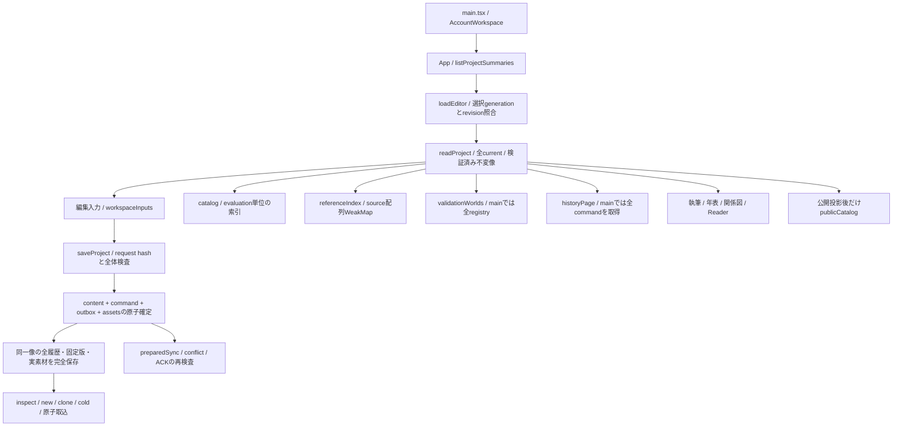

# 最新mainの実装監査

対象は `b32de9525c4acf5206ac3d6d1d23f5b90967ec95`、製品src treeは `73263a85e2ef2ead9799f91125ba54fb643182b4`。本提出で製品src・DB・schema・原CIを変更しない。第1段階の全経路監査を取り消さず、mainへの差分と残る依存を再確認した。下記の「静的」はコード追跡、「HIST」は固定された過去の実結果、新しいNode計測は別の補助証拠である。

## 現在と過去を区別した結論

PR #59は2026-10-16T15:33:26Zにマージ済み。#60の監査、#61のscope別候補準備、#62のsummary/選択読込はmainに存在する。#63〜65はそれぞれ機能ブランチへマージされ、merge commitからmainへのGitHub比較はいずれもdiverged。第2段階書の「第1段階の実装を反映したmainを起点」「未統合の場合は前提不足と独立作業を切り分ける」に従い、本PRはmain上の独立監査・研究用計測・検査を提出する。P2-06/07の製品採用は前提未充足のまま。

#60の提出HEADからmainへの比較で、製品の変更はApp、referenceChoices、probe、projectSummary、store、AccountWorkspace、BackupPanel、SyncPanel、WorldPanel、WorldVersions、alternativeDraftStatusと追加テスト。catalog、stateUsage、linkCandidates、publicCatalog、projection、WindowedList、ListWindow、contentValidationMemo、原CIはこの間の変更対象ではない。この確認を「動的全条項の再受入」とは扱わない。

## AUD-001〜023の再照合

| AUD | 最新mainでの事実・証拠区分 | 維持する境界と後続 |
| --- | --- | --- |
| 001 | 静的: App169行はsummary一覧、318行は選択後loadEditor。旧全作品読込の監査を現在の未実装扱いにしない | #62の1/10/50作品と個別破損のHIST証拠を再利用。今回のNode計測はDB一覧を測らない |
| 002 | 静的: store589/780行。選択後は全currentを読む。分割readは部分編集read modelではない | 未読/不存在/破損を区別するD02の製品変更は別単位 |
| 003 | 静的: Appのselection/startup generation、storeのepoch/revision、account固定storeを確認 | 新しい研究2案は全8owner次元と深い不変性を要求。実権限の証明にはしない |
| 004 | 静的: writeContent921行とrecordPartsDatabaseの同一取引を保持 | summary、commands、outbox、assetsの確定契約を計測のために変更しない |
| 005 | 新計測: catalog101/155行の評価内WeakMapは検索終了で失われる。同一入力・連続6検索を現行＋2案で比較 | 正規化を減らすことと全行走査を減らすことを別々に数える |
| 006 | 静的: WindowedListはfilterと全ID Mapの後にpage、ListWindowはselectedIndexのfindIndex後にslice | 30 DOM行を30 DB行と呼ばない。D07 read modelはP2-05/06統合後 |
| 007 | 静的: mainのreferenceChoicesは#61のscope別必要時準備を既に含む | 旧scope前全走査を重複修正しない。kind/順序/archived/pinの既存検査を維持 |
| 008 | 静的: ui/referenceIndexはimmutable source配列のWeakMap、600件/8msのprepare | mutable draftを入れない呼出契約が必要。研究コーパスとは別の索引・寿命 |
| 009 | 静的: author index、作者のcategory、正式リンク、自動提案、公開索引は別物 | 公開はprojection後のID/項目だけ。候補・除外を正本へ昇格しない |
| 010 | 静的: model→schema.jsonは生成済み、fieldSpecs/types/projectionは意味に応じ別定義 | collectionの公開mode=fixedと作者UIのdynamicは意図的な相違。全生成DSLへ統合しない |
| 011 | 静的: saveProject981行にはrequest hash/全体照合と差分writeがある | #63は試作不採用。未採用changesetを製品へ戻さない。今回保存時間はUNKNOWN |
| 012 | 静的: main821行のhistoryPageは全command取得後にmetadata化・slice | #64のmetadata軽量読込は未main。画面外破損を見逃す単純sliceは引き続き不採用 |
| 013 | 静的: nativeExport/archiveData/recordDictionary/workerGraph/検証sessionは既存 | 共有済みの処理を新規最適化と数えない。完全形式変更なし |
| 014 | HIST: 元88,003記録・113履歴/送信待ち・72MiBの正式完全復元は元証拠 | 今回実素材SHAを読んでもnew/clone/coldの正式再受入ではない。第3段階へ残す |
| 015 | 静的: read/import/export取消・失敗保存の既存回帰を保持 | 2000ms/600000msを変えない。研究session.closeは製品取消の代替ではない |
| 016 | 静的: store.close/epochとpersistent storage APIは別 | 研究保持は論理参照/UTF8 payload。heap/GC・実OS永続性はUNKNOWN |
| 017 | 静的: contentValidationMemoの不変性・依存・schema signature・上限とfallbackを維持 | 検証cacheを検索cacheの実測から安全と推定しない |
| 018 | 静的: 全ID、型付き参照、anchor、固定版hash、作者別案・履歴の全体制約を保持 | 研究2案は不変性しか証明せず、作品全体/履歴/権限の検証を省略しない |
| 019 | 静的: read/parts/archive/analysis/import Workerの境界を既存probeで追える | 本Node実験にWorker/DBはない。転送・worker内部CPUは今回UNKNOWN |
| 020 | 静的: Appは同一ProjectDataを執筆/年表/関係図/試読へ渡す | 隠れた画面の時間寄与・描画p95は今回UNKNOWN。D07で測る |
| 021 | 静的: nativeBridge→prepared→server検証→ACK再検査。#62はsession/generationを再確認 | 実Auth/RLS/private Storageへ接続しない。#65のACK guardは未mainのHIST |
| 022 | API観測: main保護flag=false。設定変更なし。原22外部条件を個別維持 | 実機/実Auth/ゲーム/費用/独立受入を新しい補助試験へ代入しない |
| 023 | 静的: 原CIはscope/doc/unit/3engine/aggregate、inventory/attempt/treeと復元原本を検査 | 必須テスト・fixture・assert・timeout・retry0・skip条件を変更しない |

## 原要件と外部条件

traceability.jsonは原104件のpathと116ケースの4条項への対応を保持する。freshOriginalAcceptanceは全件NOT_PERFORMED。今回の補助検査を94ローカルの再受入や22外部条件の成功として加算しない。

実機依存はB24/F31/F33/N02/N03/N04/N11/N13/E01/E11/E12、実機と実サービスの複合はF01/F34/N07/E06、専用実Auth/権限はF29/F30/N08/E05、対象ゲームはF42/E10、実費用/構成はN17。これは元22件の不足要素の分類であり、条件の除外ではない。独立レビュー等の追加不足も元EXTERNAL_CASES.mdに従う。研究コードのエージェントレビューを独立した人の原受入へ代入しない。
